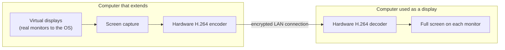

  

<h1 align="center">Osplay</h1>

  <b>Use a Mac or a Windows PC as an extended display for another computer, over your local network.</b> 
  macOS ⇄ Windows in every direction · every monitor · no cloud, no account · free and open source

  
  
  
  
  

<a href="README.tr.md">Türkçe</a>

---

Osplay turns the screen of one computer into a **real second monitor** for another computer on the
same network. The computer that extends gets virtual displays that its operating system treats like
plugged-in monitors: you arrange them, drag windows onto them and set their resolution as usual.
The other computer shows them full screen on its own monitors.

If you know Apple's Sidecar or spacedesk: Osplay does this between **Macs and Windows PCs, in both
directions**, with every monitor the other computer has.

## Features

- **Real displays.** macOS and Windows see an extra monitor, not a window or a remote session.
- **Every direction.** Mac → Windows, Windows → Mac, Mac → Mac and Windows → Windows.
- **Every monitor.** The computer used as a display lends all of its screens (up to four), and you
  can leave some out.
- **Several computers at once.** One computer can extend onto several others; all of them share
  four virtual displays.
- **Local and private.** No cloud service and no account. Devices pair once with a 6-digit code,
  and every connection is end-to-end encrypted.
- **Hardware video.** H.264 with VideoToolbox on the Mac and Media Foundation on Windows. Streams
  are 1080p by default so Wi-Fi stays smooth; 720p, 1440p and native size are one click away.
- **Swap roles in place.** One shortcut makes the display the computer that extends, without
  pairing again.
- **English and Turkish**, light and dark themes.

## What it is not

- **Not remote desktop.** No keyboard or mouse input is sent; each computer keeps its own.
- **Not for protected video.** Content with DRM (streaming services) appears black.
- **Local network only.** Both computers have to be on the same network.

## How it works

On the Mac the virtual displays come from CoreGraphics, on Windows from the open-source
[Virtual Display Driver](https://github.com/VirtualDrivers/Virtual-Display-Driver), which a small
helper service controls. One shared C++ core implements discovery (Bonjour), pairing, encryption
and the streaming protocol for both apps. Details: [`docs/ARCHITECTURE.md`](docs/ARCHITECTURE.md).

## Requirements

- **Mac:** macOS 14 Sonoma or later, Apple silicon.
- **Windows:** Windows 10 22H2 or Windows 11, x64, a GPU with hardware H.264 encoding and decoding.
- Both computers on the same local network. 5 GHz Wi-Fi works; a cable helps with several large
  displays.

## Download and install

Get the latest version from the [Releases page](https://github.com/akinalpfdn/osplay/releases/latest).

### macOS

1. Download `Osplay-<version>.dmg`, open it and drag Osplay to Applications.
2. Start Osplay; it lives in the menu bar.
3. To extend this Mac, allow **Screen Recording** when asked. Allow **Local Network** access so the
   two computers can find each other.

### Windows

1. Download `Osplay-Setup-<version>.exe` and run it.
2. The installer is not code-signed yet, so Windows SmartScreen may say "Windows protected your
   PC": choose **More info → Run anyway**.
3. The installer adds the app, the Osplay helper service, the Virtual Display Driver and the
   firewall rules Osplay needs. Osplay lives in the notification area.

## First run

1. Start Osplay on both computers.
2. On the computer that should get extra displays, choose **Extend this Mac** (or **Extend this PC**).
3. On the other one, choose **Use as display**, pick which monitors to offer, and click the
   computer in the list.
4. The first time, both screens show the same 6-digit code; confirm it on both.
5. Arrange the new displays in Osplay's Settings (Mac) or Windows' display settings, like any monitor.

| Shortcut | Mac | Windows |
|----------|-----|---------|
| Hide or show the displays (viewer) | ⌃⌥⌘V | Ctrl+Alt+Shift+V |
| Swap roles | ⌃⌥⌘S | Ctrl+Alt+Shift+S |
| Statistics overlay | ⌃⌥⌘I | Ctrl+Alt+Shift+I |

## Performance tips

- **Stream size** (next to Quality on the computer that extends) decides how much each display
  costs: 1080p suits most networks; Native gives the sharpest text on large displays and needs a
  strong host and network.
- On a Mac, AirDrop and other Apple wireless features can interrupt Wi-Fi in short bursts; see
  [Troubleshooting](docs/TROUBLESHOOTING.md) if the picture stutters.

## FAQ

**Can I use my MacBook as a second monitor for my Windows PC?**
Yes. Choose **Use as display** on the MacBook and **Extend this PC** on the PC.

**Can I use a Windows laptop as an external monitor for my Mac?**
Yes, the same way in the other direction. Mac to Mac and PC to PC work too.

**Does it need the internet or an account?**
No. Everything stays on your local network.

**Can I control the other computer with my mouse?**
No. Osplay extends the screen only; it is not a remote desktop tool.

**Is it free?**
Yes, under the MIT license.

## Security

Devices pair once by confirming a 6-digit code on both screens. Connections use the Noise protocol
(X25519, ChaCha20-Poly1305, BLAKE2b) through the shared core, and a revoked device is refused from
then on. See [`docs/SECURITY_MODEL.md`](docs/SECURITY_MODEL.md) and [`SECURITY.md`](SECURITY.md)
for reporting a vulnerability.

## Troubleshooting

See [`docs/TROUBLESHOOTING.md`](docs/TROUBLESHOOTING.md). Settings › Advanced › Diagnostics copies a
report for bug reports, with device names and network addresses hidden.

## Building from source

See [`docs/BUILDING.md`](docs/BUILDING.md) for both apps, the shared core and the tests.

## Contributing

Issues and pull requests are welcome; see [`CONTRIBUTING.md`](CONTRIBUTING.md) and the
[Code of Conduct](CODE_OF_CONDUCT.md).

## License

[MIT](LICENSE) © 2026 Akinalp Fidan.

## Credits

Osplay builds on [Virtual Display Driver](https://github.com/VirtualDrivers/Virtual-Display-Driver),
[Monocypher](https://monocypher.org), [Asio](https://think-async.com/Asio/),
[WPF-UI](https://github.com/lepoco/wpfui) and [H.NotifyIcon](https://github.com/HavenDV/H.NotifyIcon).
Full list: [`docs/THIRD_PARTY.md`](docs/THIRD_PARTY.md).
