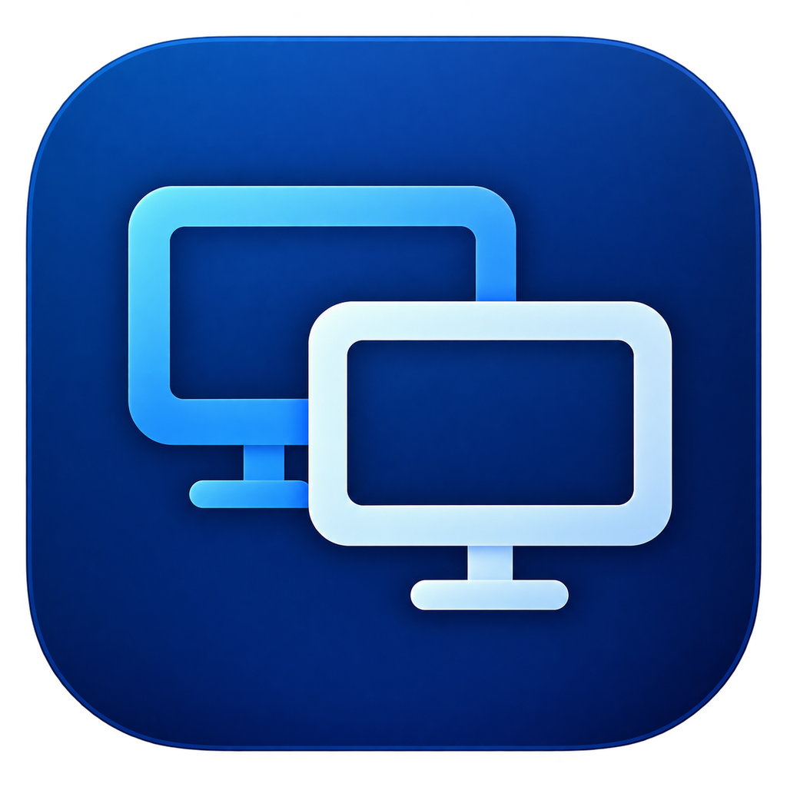
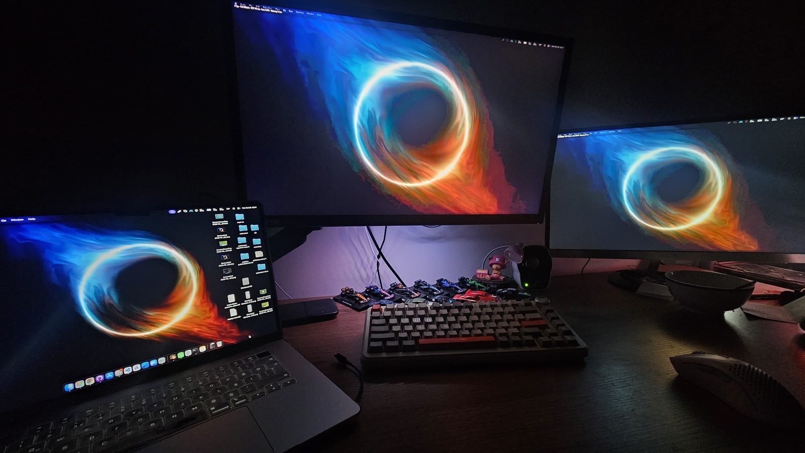
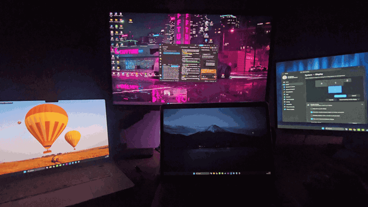
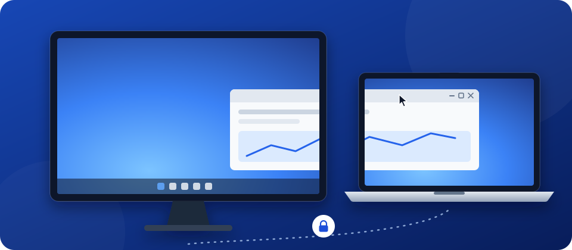
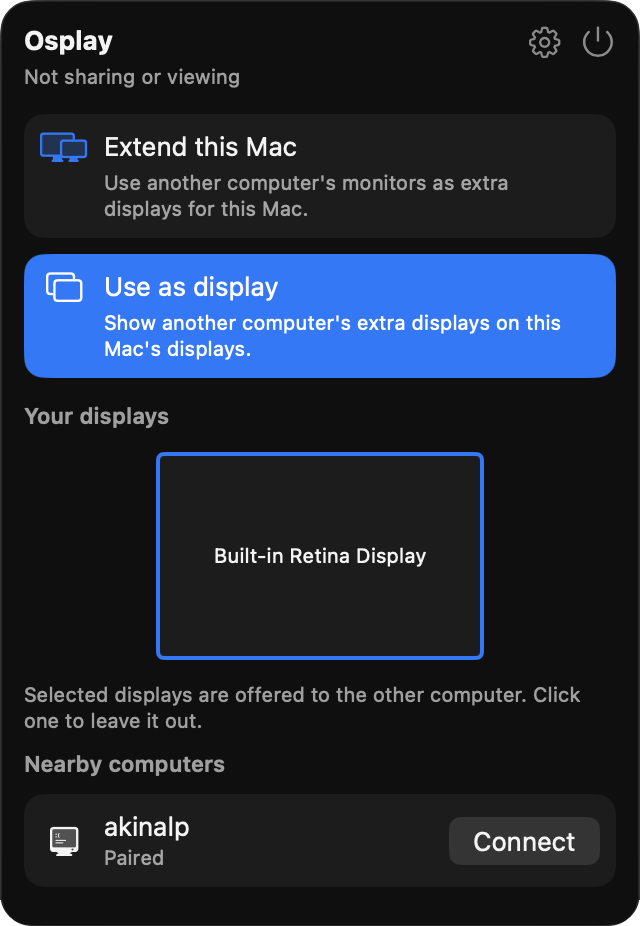

<a href="README.md">English</a>

  

<h1 align="center">Osplay</h1>

  <b>Bir Mac'i ya da Windows bilgisayarı, başka bir bilgisayar için gerçek bir ek monitöre dönüştürün.</b> 
  Yerel ağ üzerinden · Mac ⇄ Windows her yönde · Ücretsiz ve açık kaynak

  &nbsp;&nbsp;
  

  
  
  
  

  
   Bir Windows bilgisayarın iki monitörünü kendi ekranı olarak kullanan bir MacBook.

## Çalışırken

  
   Aynı anda iki MacBook'a genişleyen bir Windows bilgisayar: bir pencere bilgisayarın monitöründen bir MacBook'a geçiyor.

## Özellikler

- **Pencere değil, gerçek ekran.** macOS ve Windows ek bir monitör görür: yerleştirin, pencereleri
  üzerine sürükleyin, çözünürlüğünü ayarlayın.
- **Her yön.** Mac → Windows, Windows → Mac, Mac → Mac ve Windows → Windows.
- **Bütün monitörleriniz.** Ekran olarak kullanılan bilgisayar bütün ekranlarını sunar (en fazla
  dört) ve bir bilgisayar aynı anda birden çok bilgisayara genişleyebilir.
- **Yerel ve gizli.** Bulut ve hesap yok. Cihazlar 6 haneli bir kodla bir kez eşleşir, her bağlantı
  uçtan uca şifrelidir.
- **Donanım hızlandırmalı görüntü.** Mac'te VideoToolbox, Windows'ta Media Foundation ile H.264:
  varsayılan 1080p, doğal çözünürlüğe kadar.
- **Rolleri yerinde değiştirme.** Tek bir kısayol, ekran olan bilgisayarı genişleyen yapar.
- **Türkçe ve İngilizce**, açık ve koyu tema.

## Nasıl çalışır

  

1. Osplay'i iki bilgisayara da **kurun**.
2. Ek ekran isteyen bilgisayarda **Bu Mac'i genişlet**'i (ya da **Bu bilgisayarı genişlet**'i) seçin.
3. Diğerinde **Ekran olarak kullan**'ı seçin ve **Yakındaki bilgisayarlar** altında ilk bilgisayara
   tıklayın.
4. İlk seferde iki ekranda da aynı 6 haneli kodu onaylayın.

Bu kadar: yeni ekranlar takılı monitör gibi görünür. Onları Mac'te Osplay'in Ayarlar'ında, Windows'ta
ekran ayarlarında yerleştirin.

Arka planda, genişleyen bilgisayar sanal ekranlar kazanır (Mac'te CoreGraphics, Windows'ta açık
kaynaklı [Virtual Display Driver](https://github.com/VirtualDrivers/Virtual-Display-Driver)), bunları
yakalar, donanım H.264 kodlayıcısıyla sıkıştırır ve şifreli bir bağlantıdan gönderir. Diğer bilgisayar
görüntüyü donanımla çözer ve her ekranı tam ekran gösterir. Ortak bir C++ çekirdeği iki uygulama için
keşfi, eşleşmeyi, şifrelemeyi ve protokolü yürütür; ayrıntılar:
[`docs/ARCHITECTURE.md`](docs/ARCHITECTURE.md) (İngilizce).

 

## Kurulum

### macOS

1. [`Osplay.dmg`](https://github.com/akinalpfdn/osplay/releases/latest/download/Osplay.dmg) dosyasını
   indirin, açın ve Osplay'i Uygulamalar klasörüne sürükleyin.
2. Osplay'i başlatın; menü çubuğunda durur.
3. İki bilgisayarın birbirini bulabilmesi için **Yerel Ağ** erişimine, bu Mac'i genişletirken de
   **Ekran Kaydı**'na izin verin.

### Windows

1. [`Osplay-Setup.exe`](https://github.com/akinalpfdn/osplay/releases/latest/download/Osplay-Setup.exe)
   dosyasını indirip çalıştırın.
2. Kurulum programı kod imzalı olmadığı için SmartScreen "Windows bilgisayarınızı korudu" diyebilir:
   **Ek bilgi → Yine de çalıştır**'ı seçin. Her sürüm, kurulum programının SHA-256 değerini de yayınlar
   ([nasıl kontrol edilir](docs/TROUBLESHOOTING.md#windows-smartscreen-warns-about-the-installer),
   İngilizce).
3. Kurulum programı uygulamayı, Osplay yardımcı servisini, Virtual Display Driver'ı ve bir güvenlik
   duvarı kuralını ekler. Osplay bildirim alanında durur.

### Gereksinimler

| | |
|---|---|
| **Mac** | macOS 14 Sonoma ve üzeri, Apple silicon (Intel Mac'lerde de çalışır, test edilmedi) |
| **Windows** | Windows 10 22H2 ya da Windows 11, x64, donanım H.264 kodlama ve çözme destekleyen bir ekran kartı |
| **Ağ** | İki bilgisayar aynı yerel ağda; 5 GHz Wi-Fi yeterli, birden çok büyük ekranda kablo yardımcı olur |

## Klavye kısayolları

| İşlem | Mac | Windows |
|-------|-----|---------|
| Ekranları gizle ya da göster (ekran olarak kullanılan bilgisayarda) | ⌃⌥⌘V | Ctrl+Alt+Shift+V |
| Rolleri değiştir | ⌃⌥⌘S | Ctrl+Alt+Shift+S |
| İstatistik katmanı | ⌃⌥⌘I | Ctrl+Alt+Shift+I |

## Sık sorulan sorular

<b>MacBook'umu Windows bilgisayarım için ikinci monitör olarak kullanabilir miyim?</b>

Evet. MacBook'ta **Ekran olarak kullan**'ı, bilgisayarda **Bu bilgisayarı genişlet**'i seçin.

<b>Bir Windows laptopu Mac'im için harici monitör olarak kullanabilir miyim?</b>

Evet, ters yönde aynı şekilde. Mac'ten Mac'e ve bilgisayardan bilgisayara da çalışır.

<b>Bir bilgisayar birden çok bilgisayarı ekran olarak kullanabilir mi?</b>

Evet. Bir bilgisayar aynı anda birden çok bilgisayara genişleyebilir; toplamda en fazla dört ek ekran.

<b>İnternet ya da hesap gerekir mi?</b>

Hayır. Her şey yerel ağınızda kalır; hesap ya da bulut hizmeti yoktur.

<b>Diğer bilgisayarı fareyle kontrol edebilir miyim?</b>

Hayır. Osplay yalnızca ekranı genişletir; bir uzak masaüstü aracı değildir. Her bilgisayar kendi
klavyesini ve faresini kullanır.

<b>Yayın platformları neden siyah görünüyor?</b>

Korumalı video (DRM) işletim sistemi tarafından yakalanmaz, bu yüzden ek ekranda siyah görünür.

<b>Wi-Fi'da görüntü takılıyor. Ne yapabilirim?</b>

Genişleyen bilgisayarda **Yayın boyutu**'nu (Kalite'nin yanında) düşürün: 1080p çoğu ağa uyar. Mac'te
AirDrop ve Apple'ın diğer kablosuz özellikleri Wi-Fi'yi kısa aralıklarla kesebilir; bkz.
[Sorun giderme](docs/TROUBLESHOOTING.md) (İngilizce).

<b>Ücretsiz mi?</b>

Evet. Osplay MIT lisansıyla açık kaynaktır.

## Daha fazlası

- **Güvenlik:** cihazlar iki ekranda da 6 haneli bir kodu onaylayarak bir kez eşleşir; bağlantılar
  Noise protokolünü (X25519, ChaCha20-Poly1305, BLAKE2b) kullanır. Bkz.
  [`docs/SECURITY_MODEL.md`](docs/SECURITY_MODEL.md); güvenlik açığı bildirmek için
  [`SECURITY.md`](SECURITY.md) (İngilizce).
- **Sorun giderme:** [`docs/TROUBLESHOOTING.md`](docs/TROUBLESHOOTING.md) (İngilizce). Ayarlar ›
  Gelişmiş › Teşhis, hata bildirirken işe yarayan bir rapor kopyalar; cihaz adları ve adresler gizlenir.
- **Kaynaktan derleme:** [`docs/BUILDING.md`](docs/BUILDING.md) (İngilizce).
- **Katkıda bulunma:** hata bildirimleri ve pull request'ler memnuniyetle karşılanır; bkz.
  [`CONTRIBUTING.md`](CONTRIBUTING.md) ve [Davranış Kuralları](CODE_OF_CONDUCT.md).

## Lisans ve teşekkürler

[MIT](LICENSE) © 2026 Akinalp Fidan. Osplay şunların üzerine kuruludur:
[Virtual Display Driver](https://github.com/VirtualDrivers/Virtual-Display-Driver),
[Monocypher](https://monocypher.org), [Asio](https://think-async.com/Asio/),
[WPF-UI](https://github.com/lepoco/wpfui) ve [H.NotifyIcon](https://github.com/HavenDV/H.NotifyIcon).
Tam liste: [`docs/THIRD_PARTY.md`](docs/THIRD_PARTY.md).
