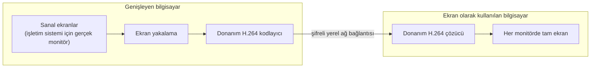

  

<h1 align="center">Osplay</h1>

  <b>Bir Mac'i ya da Windows bilgisayarı, yerel ağınızdaki başka bir bilgisayar için ek ekran olarak kullanın.</b> 
  macOS ⇄ Windows her yönde · bütün monitörler · bulut ve hesap yok · ücretsiz ve açık kaynak

  
  
  
  
  

  <a href="https://github.com/akinalpfdn/osplay/releases/latest/download/Osplay.dmg"><b>Mac için indir</b></a> ·
  <a href="https://github.com/akinalpfdn/osplay/releases/latest/download/Osplay-Setup.exe"><b>Windows için indir</b></a> ·
  <a href="README.md">English</a>

---

Osplay, bir bilgisayarın ekranını aynı ağdaki başka bir bilgisayar için **gerçek bir ikinci
monitöre** dönüştürür. Genişleyen bilgisayar, işletim sisteminin takılı bir monitör gibi gördüğü
sanal ekranlar kazanır: onları her zamanki gibi yerleştirir, pencereleri üzerlerine sürükler ve
çözünürlüklerini ayarlarsınız. Diğer bilgisayar bu ekranları kendi monitörlerinde tam ekran
gösterir.

Apple'ın Sidecar'ını ya da spacedesk'i biliyorsanız: Osplay aynı işi **Mac'ler ve Windows
bilgisayarlar arasında, her iki yönde**, diğer bilgisayarın bütün monitörleriyle yapar.

## Özellikler

- **Gerçek ekranlar.** macOS ve Windows bir pencere ya da uzak oturum değil, ek bir monitör görür.
- **Her yön.** Mac → Windows, Windows → Mac, Mac → Mac ve Windows → Windows.
- **Bütün monitörler.** Ekran olarak kullanılan bilgisayar bütün ekranlarını sunar (en fazla
  dört); istediklerinizi dışarıda bırakabilirsiniz.
- **Aynı anda birden çok bilgisayar.** Bir bilgisayar birden çok bilgisayara genişleyebilir;
  hepsi dört sanal ekranı paylaşır.
- **Yerel ve gizli.** Bulut hizmeti ve hesap yok. Cihazlar 6 haneli bir kodla bir kez eşleşir ve
  her bağlantı uçtan uca şifrelidir.
- **Donanım hızlandırmalı görüntü.** Mac'te VideoToolbox, Windows'ta Media Foundation ile H.264.
  Wi-Fi akıcı kalsın diye yayınlar varsayılan olarak 1080p; 720p, 1440p ve doğal boyut bir tık
  uzakta.
- **Rolleri yerinde değiştirme.** Tek bir kısayol, ekran olan bilgisayarı genişleyen yapar;
  yeniden eşleşme gerekmez.
- **Türkçe ve İngilizce**, açık ve koyu tema.

## Ne değildir

- **Uzak masaüstü değildir.** Klavye ya da fare girdisi gönderilmez; her bilgisayar kendi
  girdisini kullanır.
- **Korumalı video için değildir.** DRM'li içerik (yayın platformları) siyah görünür.
- **Yalnızca yerel ağ.** İki bilgisayar aynı ağda olmalıdır.

## Nasıl çalışır

Sanal ekranlar Mac'te CoreGraphics'ten, Windows'ta ise küçük bir yardımcı servisin yönettiği açık
kaynaklı [Virtual Display Driver](https://github.com/VirtualDrivers/Virtual-Display-Driver)'dan
gelir. Ortak bir C++ çekirdeği iki uygulama için keşfi (Bonjour), eşleşmeyi, şifrelemeyi ve yayın
protokolünü uygular. Ayrıntılar: [`docs/ARCHITECTURE.md`](docs/ARCHITECTURE.md) (İngilizce).

## Gereksinimler

- **Mac:** macOS 14 Sonoma ve üzeri, Apple silicon. Uygulama Intel Mac'lerde de çalışır, ama test
  edilmedi.
- **Windows:** Windows 10 22H2 ya da Windows 11, x64, donanım H.264 kodlama ve çözme destekleyen
  bir ekran kartı.
- İki bilgisayar aynı yerel ağda. 5 GHz Wi-Fi yeterli; birden çok büyük ekranda kablo yardımcı
  olur.

## İndirme ve kurulum

En son sürümü [Sürümler sayfasından](https://github.com/akinalpfdn/osplay/releases/latest) indirin.

### macOS

1. [`Osplay.dmg`](https://github.com/akinalpfdn/osplay/releases/latest/download/Osplay.dmg) dosyasını indirin, açın ve Osplay'i Uygulamalar klasörüne
   sürükleyin.
2. Osplay'i başlatın; menü çubuğunda durur.
3. Bu Mac'i genişletmek için sorulduğunda **Ekran Kaydı**'na izin verin. İki bilgisayarın
   birbirini bulabilmesi için **Yerel Ağ** erişimine izin verin.

### Windows

1. [`Osplay-Setup.exe`](https://github.com/akinalpfdn/osplay/releases/latest/download/Osplay-Setup.exe) dosyasını indirip çalıştırın.
2. Kurulum programı kod imzalı olmadığı için Windows SmartScreen "Windows bilgisayarınızı korudu"
   diyebilir: **Ek bilgi → Yine de çalıştır**'ı seçin. Her sürüm, kurulum programının SHA-256
   değerini de yayınlar
   ([nasıl kontrol edilir](docs/TROUBLESHOOTING.md#windows-smartscreen-warns-about-the-installer),
   İngilizce).
3. Kurulum programı uygulamayı, Osplay yardımcı servisini, Virtual Display Driver'ı ve Osplay'in
   ihtiyaç duyduğu güvenlik duvarı kurallarını ekler. Osplay bildirim alanında durur.

## İlk kullanım

1. Osplay'i iki bilgisayarda da başlatın.
2. Ek ekran kazanacak bilgisayarda **Bu Mac'i genişlet**'i (ya da **Bu bilgisayarı genişlet**'i)
   seçin.
3. Diğerinde **Ekran olarak kullan**'ı seçin, sunulacak monitörleri belirleyin ve listedeki
   bilgisayara tıklayın.
4. İlk seferde iki ekranda da aynı 6 haneli kod görünür; ikisinde de onaylayın.
5. Yeni ekranları her monitör gibi Osplay'in Ayarlar'ında (Mac) ya da Windows'un ekran
   ayarlarında yerleştirin.

| Kısayol | Mac | Windows |
|---------|-----|---------|
| Ekranları gizle ya da göster (ekran olan bilgisayar) | ⌃⌥⌘V | Ctrl+Alt+Shift+V |
| Rolleri değiştir | ⌃⌥⌘S | Ctrl+Alt+Shift+S |
| İstatistik katmanı | ⌃⌥⌘I | Ctrl+Alt+Shift+I |

## Performans ipuçları

- Genişleyen bilgisayardaki **Yayın boyutu** (Kalite'nin yanında) her ekranın maliyetini belirler:
  1080p çoğu ağa uyar; Doğal büyük ekranlarda en keskin yazıyı verir ama güçlü bir bilgisayar ve
  ağ ister.
- Mac'te AirDrop ve Apple'ın diğer kablosuz özellikleri Wi-Fi'yi kısa aralıklarla kesebilir;
  görüntü takılıyorsa [Sorun giderme](docs/TROUBLESHOOTING.md) belgesine bakın (İngilizce).

## Sık sorulan sorular

**MacBook'umu Windows bilgisayarım için ikinci monitör olarak kullanabilir miyim?**
Evet. MacBook'ta **Ekran olarak kullan**'ı, bilgisayarda **Bu bilgisayarı genişlet**'i seçin.

**Bir Windows laptopu Mac'im için harici monitör olarak kullanabilir miyim?**
Evet, ters yönde aynı şekilde. Mac'ten Mac'e ve bilgisayardan bilgisayara da çalışır.

**İnternet ya da hesap gerekir mi?**
Hayır. Her şey yerel ağınızda kalır.

**Diğer bilgisayarı fareyle kontrol edebilir miyim?**
Hayır. Osplay yalnızca ekranı genişletir; bir uzak masaüstü aracı değildir.

**Ücretsiz mi?**
Evet, MIT lisansıyla.

## Güvenlik

Cihazlar iki ekranda da 6 haneli bir kodu onaylayarak bir kez eşleşir. Bağlantılar ortak çekirdek
üzerinden Noise protokolünü (X25519, ChaCha20-Poly1305, BLAKE2b) kullanır; iptal edilen bir cihaz
o andan itibaren reddedilir. Ayrıntılar [`docs/SECURITY_MODEL.md`](docs/SECURITY_MODEL.md), güvenlik
açığı bildirmek için [`SECURITY.md`](SECURITY.md) (İngilizce).

## Sorun giderme

[`docs/TROUBLESHOOTING.md`](docs/TROUBLESHOOTING.md) (İngilizce). Ayarlar › Gelişmiş › Teşhis,
hata bildirirken işe yarayan bir rapor kopyalar; cihaz adları ve ağ adresleri gizlenir.

## Kaynaktan derleme

İki uygulama, ortak çekirdek ve testler için [`docs/BUILDING.md`](docs/BUILDING.md) (İngilizce).

## Katkıda bulunma

Hata bildirimleri ve pull request'ler memnuniyetle karşılanır; bkz.
[`CONTRIBUTING.md`](CONTRIBUTING.md) ve [Davranış Kuralları](CODE_OF_CONDUCT.md).

## Lisans

[MIT](LICENSE) © 2026 Akinalp Fidan.

## Teşekkürler

Osplay şunların üzerine kuruludur:
[Virtual Display Driver](https://github.com/VirtualDrivers/Virtual-Display-Driver),
[Monocypher](https://monocypher.org), [Asio](https://think-async.com/Asio/),
[WPF-UI](https://github.com/lepoco/wpfui) ve [H.NotifyIcon](https://github.com/HavenDV/H.NotifyIcon).
Tam liste: [`docs/THIRD_PARTY.md`](docs/THIRD_PARTY.md).
